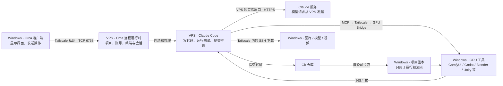
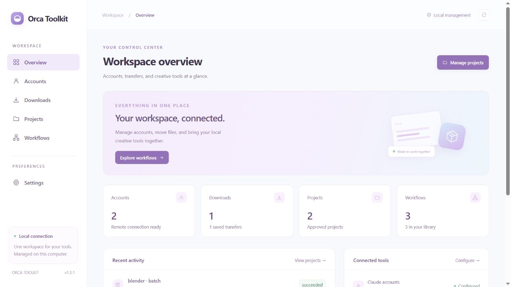
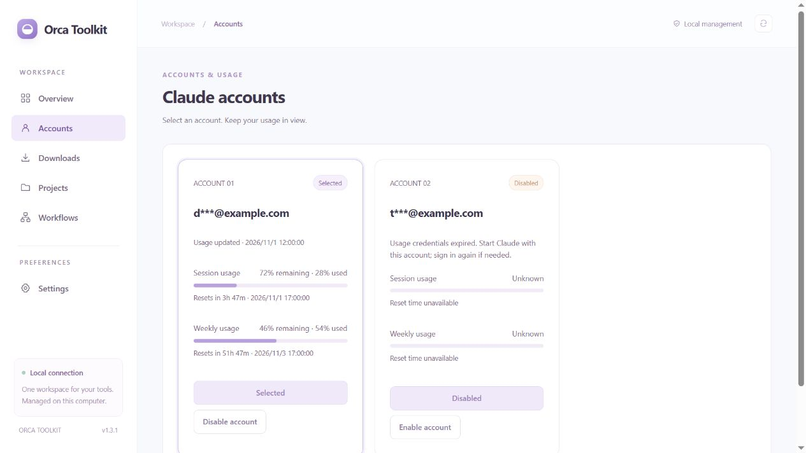
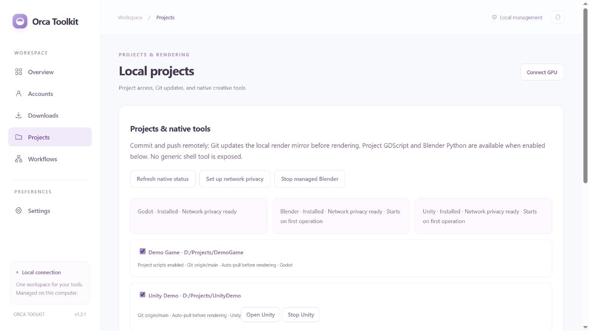
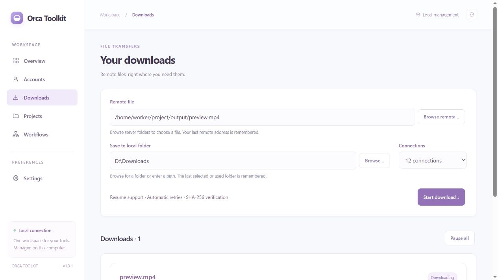

# Claude Code 远程开发：部署与使用图解

适用：**Windows Orca 客户端 + VPS Orca 远程运行时 + VPS Claude Code + Tailscale + 本机 GPU + Orca Toolkit**。按当前这套工作方式整理，更新于 2026-11-04。

> 先读「二、Tailscale：先搭好私网与隐私边界」；已部署好的机器随后看「三、每天怎么用」。截图使用工具集的演示数据，不包含真实账号、地址和令牌。

## 一、先理解这套环境



| 组件 | 负责什么 |
| --- | --- |
| Windows Orca 客户端 | 显示界面，连接 VPS 的 Orca，发送操作 |
| VPS Orca 远程运行时 | 常驻 VPS，管理远程项目、账号、终端和会话，启动 Claude Code |
| Claude Code | 在 VPS 上开发，通过 MCP 调用本机工具 |
| Tailscale | 加密连接本机与 VPS，承载 Orca、SSH 下载及 GPU 调用 |
| Orca Toolkit | 一个网页管理账号、下载、项目、工作流 |
| GPU Bridge | 在 Windows 上执行任务；不依赖 Codex 服务 |

**两端都安装 Orca：Windows 提供界面，VPS 运行无界面的 Orca 服务和 Claude Code。**代码在 VPS 开发，本机只保留渲染副本；项目同步只走 Git。VPS 不是直接获得一块显卡，而是把任务交给本机执行。

## 二、Tailscale：先搭好私网与隐私边界

**这是整套方案的网络基础。**本机通过 Tailscale 操作 VPS，Claude Code 本体运行在 VPS；本机 GPU 再通过同一私网接任务。需要关注的有三条边界：

| 链路/信息 | 这套方案怎么处理 |
| --- | --- |
| 本机 ↔ VPS | 使用 Tailscale 私网地址与加密链路，不把管理服务直接暴露到公网 |
| VPS → Claude 服务 | 请求从 VPS 发起，实际出口由 VPS 的路由、代理或出口节点决定 |
| 本机信息 → VPS Claude | 限制 Tailscale 管理元数据读取，配合工具结果过滤与执行程序网络规则 |

Tailscale 默认只接管 tailnet 内的通信，不自动改变所有上网流量；启用 Exit Node 才涉及公共互联网流量的出口调整。**保护本机链路、限制信息泄露是这里的目的，不能把“安装 Tailscale”理解为账号一定不会受限。**[官方出口节点说明](https://tailscale.com/docs/features/exit-nodes)

### 1. 两端安装，加入同一个 tailnet

1. **Windows**：从[官方页面](https://tailscale.com/docs/install/windows)安装，托盘图标中登录。
2. **VPS**：由 root 按[官方 Linux 步骤](https://tailscale.com/docs/install/linux)安装；新节点执行 `tailscale up`，按提示完成登录。已配置节点不要反复初始化。
3. 在 Tailscale 管理台 **Machines** 确认两台设备均在线、已获授权，并分别记录私网 IPv4。地址通常来自 `100.64.0.0/10`，不要拿公网 IP 代替。
4. 确认 Windows Tailscale 服务和 VPS `tailscaled` 自动启动；设备登录/密钥过期时先恢复认证。

### 2. 所有连接填私网地址，按方向放行

| 从哪里 → 到哪里 | 用途与端口 |
| --- | --- |
| 本机 → VPS 私网 IPv4 | Orca：TCP 6768；SSH 下载/管理：TCP 22 |
| VPS → 本机私网 IPv4 | GPU Bridge：TCP 18772，仅允许指定 VPS 来源，并校验令牌 |
| 本机 → 本机回环地址 | 统一管理页 18774、ComfyUI 等，不向 VPS/公网直接开放 |

Orca 远程端点、Downloads 的 SSH 地址填写 **VPS 私网地址**；Bridge 的 `listen` 填 **本机私网地址**，`allowed_peers` 填 **VPS 私网地址**。tailnet 访问策略和系统防火墙都要允许必要的方向，连通后再收紧公网入口。当前环境已经完成收紧。

这里使用的是 **Tailscale 私网里的 OpenSSH**，无需为下载额外启用 Tailscale SSH，也无需开启公开服务的 Funnel。

### 3. 兼容 Clash/TUN，先做连接检查

Clash/TUN 若接管了私网目标，应让 Tailscale 地址段 `100.64.0.0/10`、`fd7a:115c:a1e0::/48` 交由 **Tailscale 接口路由**，不要送进代理节点或默认公网出口。具体设置取决于客户端，不能只凭开着 TUN 就认定路径正确。[官方多 VPN 共存说明](https://tailscale.com/docs/reference/faq/other-vpns)

在 **Windows PowerShell** 检查，先替换示例变量：

```powershell
$vpsIp = '替换为VPS的Tailscale私网IPv4'
tailscale ip -4
tailscale ping --c=3 $vpsIp
Test-NetConnection -ComputerName $vpsIp -Port 6768
Test-NetConnection -ComputerName $vpsIp -Port 22
```

两个端口应显示 `TcpTestSucceeded: True`。`tailscale ping` 成功只证明设备链路可用，不代表应用已启动。直连和 DERP 中继都保持端到端加密；中继可能影响速度，不等于泄露明文。[连接方式](https://tailscale.com/docs/reference/device-connectivity) · [加密说明](https://tailscale.com/docs/concepts/tailscale-encryption)

### 4. 别漏掉本机信息隔离

Tailscale 不是匿名工具，对端设备的管理员可能查看连接端点。当前 VPS 已限制普通 Claude 用户访问 Tailscale LocalAPI；它不能执行 `tailscale status` 是**预期保护**，不应为排错恢复权限。相关诊断由管理员执行，只反馈必要结果。新部署按后文的 `protect-tailnet-metadata.sh` 完成这一步。

工具还会过滤标准结果中的本机身份、地址和硬件字段；已有文件、Git 历史和任意脚本并不会因此自动完成隐私清洗。

## 三、每天怎么用

### 1. 开机、连接、打开统一入口

1. Windows 开机并登录用户，确认两端 Tailscale 在线，VPS 私网端口可达。
2. 打开 Windows Orca，连接 **VPS Orca 服务器**，打开 VPS 上的项目；VPS 的 `orca-server.service` 应保持运行。
3. 按 **Ctrl+Alt+T**，进入 `http://127.0.0.1:18774/`。



已配置自启后，Bridge 在 Windows 登录后启动；ComfyUI 只有启用了 `comfy_startup.enabled` 才会自动拉起。首次加载模型和节点需要等待。

### 2. 选账号，再新建 Claude 会话

进入 **Accounts** → **Use this account** → 确认 **Selected** → 回到远程项目新建 Claude 会话。



- 这里选的是 **VPS 账号**。切换不迁移已有会话，旧会话可能继续使用原账号。
- 不想误选的 Free 账号点 **Disable account**；不会删除登录态或中断任务，仅限制 Toolkit 内的切换。
- 用量未知不等于用完。先点刷新；凭据过期时在对应账号启动 Claude，必要时重新登录。

在 Claude 输入 `/mcp`，检查 `local-gpu` 及需要的 `godot-local`、`blender-local`、`unity-local`、`vroid-local`、`tripo-local`。无需每次开机重新安装插件。[Claude 官方 MCP 说明](https://code.claude.com/docs/en/mcp)

### 3. 开发 → 推送 → 本机执行 → 取回结果

先在 **Projects** 确认：项目已启用、仓库/分支正确、开启 **Auto-pull before rendering**；执行原生工具前应显示 **Network privacy ready**。



把下面这段发给 VPS 上的 Claude，替换项目 ID 和具体需求：

```text
项目 ID：game。需求：修改主菜单，并给我一张运行截图。
1. 先读项目说明，在 VPS 修改代码并完成相关验证。
2. 将需要本机执行的代码提交并推送到配置分支。
3. 检查本机工具状态，调用 project_git pull，并确认任务成功。
4. 使用对应引擎的工具打开项目、运行或截图。
5. 查询原任务直到完成，把产物下载到 VPS，告诉我最终文件路径。
不要重复提交任务，也不要用一堆后台 sleep 命令等待。
```

**未 push 的代码不会同步。本机受跟踪文件的修改可被覆盖，不作为开发成果保存。**长任务使用原 `job_id` 查询；原生任务可用 `wait_native_job`，不要看到等待超时就重新生成。

| 想做什么 | 给 Claude 的指令示例 |
| --- | --- |
| 生图、音效、多语言配音、建模 | “列出可用 ComfyUI 工作流和输入参数，先做一个小样，完成后取回文件。” |
| Godot 截图/脚本 | “同步项目，使用 Godot 工具拍指定场景，带上需要的场景参数。” |
| Blender 建模/动画/渲染 | “先查询场景，执行项目脚本，保存场景并声明输出文件，再取回产物。” |
| Unity 编辑、测试、打包 | “先读取当前工具列表；编译通过后运行测试，再执行已确认的构建任务。” |
| Tripo / VRoid | “先查询能力与状态，再执行生成、修改或导出；不要猜接口参数。” |

可用能力取决于本机已安装的软件、节点、模型、许可与当前 MCP 工具列表。

### 4. 把 VPS 文件下载到 Windows

按 **Ctrl+Alt+D** → **Browse remote…** 选择 VPS 文件 → **Browse…** 选择本机目录 → **Start download**。



两端目录会分别记住。支持暂停、续传和 SHA-256 校验；连接数是并发上限，小文件或收尾阶段不一定占满全部连接。

## 四、首次部署：Tailscale → VPS Orca → Windows 工具集 → MCP

你当前环境已完成部署；以下用于新机器复现。所有命令在本仓库根目录执行，示例路径、用户名和 IP 必须换成自己的。

### A. 准备两端环境

| Windows | VPS |
| --- | --- |
| Orca、Tailscale、Python 3.10+、Node 18+、Git、OpenSSH Client | Orca 远程运行时、Tailscale、Python 3.10+、Git、OpenSSH Server、Claude Code |
| 按需安装 ComfyUI、Godot、Blender、Unity、VRoid 等 | 使用普通用户运行 Orca/Claude；Claude 账号已正常登录 |

先按「二」让 Tailscale 私网连通；全新 VPS 此时还没有 Orca，6768 不通是正常的，完成下一步后再测。两端准备本仓库源码；Claude 的首次安装/登录见[官方快速开始](https://code.claude.com/docs/en/quickstart)。

### B. VPS 安装 Orca、启动服务并配对

VPS 不需要安装图形桌面，但需要 **Orca 程序本身和它的 CLI**。只安装 Claude Code 或只连接 SSH，不等于已经部署远程 Orca。

1. 从 [Orca 官方 Releases](https://github.com/stablyai/orca/releases)下载匹配 VPS 架构的 Linux `.deb`。当前使用 Ubuntu x64，对应 `amd64`；核对发布包后，由 **root** 安装，例如 `apt install /tmp/orca-ide_实际版本_amd64.deb`。
2. 确认防火墙只向授权的 Tailscale 来源开放 6768。切换到运行 Claude 的普通用户，在首次部署时启动：

```bash
# VPS 普通用户执行；先把变量替换为 VPS 的私网 IPv4
vps_ip='替换为VPS的Tailscale私网IPv4'
orca-ide serve --port 6768 --pairing-address "$vps_ip"
```

3. 复制终端中的配对链接，在 **Windows Orca → Settings → Remote Orca Servers → Add Server** 添加服务器，命名后连接。链接相当于临时凭据，不能贴进教程、公开聊天或截图。
4. 先在指纹浏览器的独立配置中设置 **VPS 代理出口**，核实实际出口后直接打开 Claude 官方网站完成注册/登录。然后在另一个 **同一 VPS 普通用户**终端执行 `orca-ide account add --agent claude`，将本次官方授权链接私下打开在这份浏览器配置中，按提示完成授权；用 `orca-ide account list` 确认，再启动一次 Claude。Windows 上登录的账号不会自动变成 VPS 账号。代理准备、默认浏览器误开及出口检查详见[注册与登录步骤](deployment-center.md#注册与登录指纹浏览器使用-vps-出口)。
5. 添加已有的 VPS 项目，例如 `orca-ide repo add --path /home/workspace/Projects/mygame`，再从 Windows Orca 打开它。
6. 首次配对验证后，把前台进程交由 systemd 常驻；完整示例见 **[VPS Orca 安装、自启与维护](vps-orca.md)**。当前机器已配置 `orca-server.service`，不要重复启动第二份。

注意：`--pairing-address` **只改变宣告给客户端的地址，不限制监听接口**；公网限制仍由防火墙实施。Linux 外部终端使用 `orca-ide`，不要误调用同名的 GNOME 屏幕阅读器 `orca`。[官方远程服务器说明](https://www.onorca.dev/docs/remote-servers)

VPS Orca 常驻后，Windows 客户端断开不会仅因此结束远程任务；VPS 重启、OOM 或进程故障仍可能打断任务。

### C. Windows 安装 Toolkit 与 GPU Bridge

```powershell
Set-Location E:\code\orca-tools
node scripts/build-toolkit-ui.cjs
node plugins/toolkit/Install.cjs
Copy-Item scripts/gpu-settings.example.json scripts/gpu-settings.local.json
notepad scripts/gpu-settings.local.json
```

修改私有配置：`listen` 填本机 Tailscale IPv4；`allowed_peers` 填 VPS 私网地址；填写软件、工作流和本机 Git 副本路径。需要 ComfyUI 自启时配置 `comfy_startup`。然后执行：

```powershell
python scripts/install-local-gpu.py --settings scripts/gpu-settings.local.json
node tools/orca-startup/install.cjs
```

在 Orca **Settings → Plugins** 刷新、审核并启用 Toolkit；首次防火墙安装需要 Windows 管理员确认。持久规则不需要每次重启重装。启动助手从下次 Windows 登录起等待 Orca 并激活已审核的插件。

打开统一页的 **Settings**，为 Accounts / Downloads 选择同一个 VPS 环境；下载地址使用 VPS 的 Tailscale IPv4，SSH 用户填运行远程 Orca 的普通用户。不要同时启用旧的独立下载/GPU 入口插件。[详细部署](toolkit.md)

### D. VPS 安装 MCP

1. 通过已授权的私密通道，把 Windows 的 `%LOCALAPPDATA%\LocalGpuBridge\client.local.json` 传给 VPS；它含令牌，**不要贴进对话、截图或 Git**。传输与配置见 [GPU 部署步骤](gpu-bridge.md#4-私下传输连接配置)。
2. **VPS root 管理员**在仓库目录执行一次，`workspace` 替换为实际普通用户：

```bash
sh services/local-gpu-bridge/protect-tailnet-metadata.sh workspace
```

3. 私有配置放到普通用户可读的位置并设为 `600`；以运行 Claude 的**普通用户**安装，账号配置目录从 Orca 的账号设置确认：

```bash
chmod 600 ~/gpu-client.local.json
python3 scripts/install-vps-gpu.py --client-config ~/gpu-client.local.json \
  --claude-config-dir "/实际的Claude账号配置目录"
```

多账号需要对每个配置目录安装一次；这里填账号配置目录，不是项目目录。安装成功后清理中转文件，保留最终的 `~/.config/local-gpu-bridge/client.json`。

已有 Claude 会话执行 `/reload-plugins`，再用 `/mcp` 检查；新会话会加载已安装版本。[Claude 官方插件加载说明](https://code.claude.com/docs/en/discover-plugins)

### E. 验收

- VPS `orca-server.service` 为 active；Windows Orca 显示远程服务器 Connected，能列出 VPS 项目和终端。
- **Accounts** 能看到 VPS 账号；**Projects** 的路径、分支和隐私状态正确。
- **Workflows** 至少一个需要使用的工作流显示 **Ready**。
- 让 Claude 查询 GPU 状态、列项目、完成一次小任务并取回文件。
- 在 Downloads 实际下载一次，确认保存目录与校验成功。

## 五、更新与排错速查

| 遇到什么 | 怎么处理 |
| --- | --- |
| Tailscale 在线但 Orca/下载不通 | 检查是否填写私网地址、TUN 是否抢路由，再分别测 6768/22；检查 tailnet 策略、系统防火墙与设备认证 |
| VPS 普通用户无法执行 tailscale status | 当前元数据隔离的预期结果；让管理员诊断，不要直接解除保护 |
| Tailscale 通，但 6768 没有 Orca 响应 | 管理员查 `systemctl status orca-server.service`；应用是否运行与网络连通分别检查 |
| Orca 提示插件重新审核 | 源码变化后按插件页提示审核、启用；刷新网页不等于加载新插件 |
| Claude 看不到新工具 | 在对应账号的会话执行 `/reload-plugins`，再 `/mcp`；不是在 Windows 管理页输入 |
| 本机 Bridge 程序更新 | 等任务结束、保存受管理编辑器内容后再重启 Bridge；不必每次重启整台电脑 |
| GPU 离线 | 依次查本机已登录、Tailscale、Bridge、令牌/来源白名单，再检查 ComfyUI 是否就绪 |
| 工作流 Unavailable | 查缺失节点、模型和 ComfyUI 启动日志；不能靠重新配对解决 |
| 渲染完成却没有文件 | 检查保存输出节点，例如音频要接 Save Audio；预览节点未必产生可下载文件 |
| Git 拉取失败/画面旧 | 查 VPS 是否已 push、分支、非交互凭据、文件占用；TUN 应正确放行私网，不额外叠加未经验证的代理 |
| 后台等待报 143 | 查真正的 job 状态；143 可能只是等待进程被结束，不代表渲染失败 |
| 会话历史提示 runtime 超时 | 先刷新并检查 Orca 连接；不能仅凭提示认定 GPU、CrowdSec 或配对损坏 |

## 六、这套环境的权限与时间约定

- 当前 VPS → 本机只开放必要的 GPU Bridge 通道；SSH 管理限定管理电脑的 Tailscale 来源，管理网页不开放公网。
- 换新电脑或 Tailscale 地址改变时，由管理员先更新来源白名单，不要为排错开放公网端口。
- CrowdSec 负责本地检测/封禁；Lynis 每周审计并保留 root 私有报告。日常使用无需手工关闭它们。
- 标准工具结果过滤身份、网络与硬件信息；**原生脚本仍有本机用户的文件权限，只运行可信项目**，不把端口限制当作完整沙箱。
- 文件回传以接收 VPS 的时钟记录时间，当前为 UTC；以回执的最终文件路径为准。文件内部 EXIF、媒体元数据及已有 Git 历史不会自动改写。
- 本仓库在 Windows 手动运行 Git 时使用 `python scripts/git-vps-time.py <Git参数>`，例如 `python scripts/git-vps-time.py pull`，保持新 Git 操作使用 UTC。

更多配置：[VPS Orca](vps-orca.md) · [账号](account-switcher.md) · [下载](parallel-download.md) · [GPU](gpu-bridge.md) · [Unity](unity.md) · [Tripo](tripo.md) · [VRoid](vroid.md) · [运维](operations.md)
